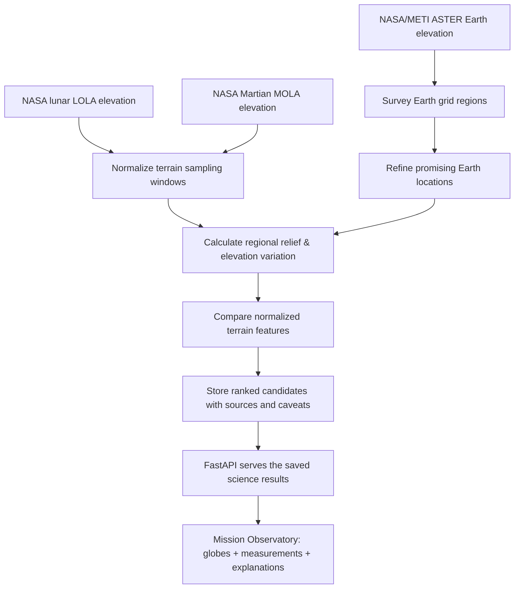

# PLANETREX
### Explore the Moon and Mars. Discover their terrain counterparts on Earth.

**PLANETREX** is an interactive planetary analog discovery prototype inspired by the NASA Space Apps challenge to identify terrestrial environments useful for future Moon-base and Mars exploration research.

Instead of matching places only because they *look* similar, PLANETREX starts with real elevation measurements and explains **what is comparable, what is different, and what remains unknown**.

### 🌍 [Open the live PLANETREX Mission Observatory](https://planetrex-explorer.onrender.com/observatory)

[Explore the application](https://planetrex-explorer.onrender.com/observatory) · [View the scientific data coverage](https://planetrex-explorer.onrender.com/science/coverage) · [Inspect the generated terrain dataset](data/terrain_survey.json)

---

## What you can explore

**01 — Choose the Moon or Mars.** Switch between the two planetary bodies and select a mapped research or mission site, such as Hadley Rille, Taurus–Littrow, Jezero Crater, or Gale Crater.

**02 — Explore both worlds together.** Interactive, textured globes show the planetary reference and its candidate Earth regions. Rotate and zoom, view both globes side by side, or focus on one globe at a time.

**03 — Discover potential Earth analogs.** PLANETREX retrieves a precomputed shortlist of Earth locations with measured terrain characteristics closest to the selected lunar or Martian reference. Selecting a candidate focuses the Earth globe on that region.

**04 — Understand the measurements.** A compact scientific panel compares regional elevation relief and elevation variation in metres, and shows an explainable **terrain distance**. Separate Earth-only context includes air temperature and elevation when the source responds.

**05 — Understand where the analogy breaks.** The app identifies missing data and major physical differences — including gravity, atmosphere, and radiation — and describes possible field-testing applications without declaring any site safe for a permanent base.

## How PLANETREX works



The central idea is **data first, visualization second**. Terrain measurements are collected and processed in batch; the website reads the stored results instead of repeating the global analysis on every visit.

### How a terrain match is calculated

Each candidate and reference is represented by two measurements from a roughly **24 km-wide sampling footprint**:

- **Elevation relief:** highest sampled elevation minus lowest sampled elevation.
- **Elevation variation:** standard deviation of the sampled elevations.

The prototype compares their transformed differences:

```text
terrain distance =
    0.6 × |log(1 + Moon/Mars relief) − log(1 + Earth relief)|
  + 0.4 × |log(1 + Moon/Mars elevation variation)
         − log(1 + Earth elevation variation)|
```

**A lower terrain distance means a closer match in these two terrain descriptors.** It is **not** a percentage, a validated geological similarity score, or a prediction of landing or base suitability. The evidence report also checks how rankings respond to alternative feature weights.

## What has been analyzed so far

| Scientific research pilot | Current result |
| --- | --- |
| Initial Earth survey | **198** coarse grid positions checked |
| Earth regions with usable initial elevation samples | **72** |
| Additional nearby regions with usable refined samples | **96** |
| Documented Moon/Mars terrain reference regions | **8** |
| Dimensions used in the current paired ranking | **1 of 8: topography** |
| Terrain features compared within that dimension | **2: relief and elevation variation** |

The Earth survey is **coarse-to-fine**, not an exhaustive search of every location on the planet. It uses a degree-based grid, does not yet independently verify land cover for every candidate, and does not prove that any location is a new or scientifically validated analog.

## Where the scientific data comes from

| Source | Role in PLANETREX |
| --- | --- |
| [NASA LRO LOLA](https://svs.gsfc.nasa.gov/4720/) | Measured lunar elevation used for reference terrain profiles |
| [NASA Mars Global Surveyor MOLA](https://pds-geosciences.wustl.edu/missions/mgs/megdr.html) | Measured Martian elevation used for reference terrain profiles |
| [NASA/METI ASTER GDEM via Open Topo Data](https://www.opentopodata.org/datasets/aster/) | Sampled Earth elevation used in the terrain rankings |
| [NASA POWER](https://power.larc.nasa.gov/) | Historical Earth air temperature, wind, precipitation, and solar context, **not** paired planetary similarity measurements |
| [NASA Terra MODIS / ORNL DAAC](https://modis.ornl.gov/data/modis_webservice.html) | Quality-screened Earth land-surface temperature context |
| [Macrostrat](https://macrostrat.org/) | Published Earth geological-map context; **not** a measured Earth–Moon/Mars mineral match |
| [NASA/USGS MRO CTX stereo DTMs](https://stac.astrogeology.usgs.gov/docs/data/mars/ctxdtms/) | Additional Martian terrain scenes and archive evidence; not yet incorporated into the main analog score |
| [NASA Earthdata](https://search.earthdata.nasa.gov/) and [NASA PDS](https://pds.nasa.gov/) | Scientific dataset and planetary archive discovery |

**Visuals are separate from measurements.** Planet globe textures come from [Solar System Scope](https://www.solarsystemscope.com/textures/) (CC BY 4.0); textures are visual assets, not the scientific topographic data used to rank analogs.

## How the application is built

- **Scientific processing — Python:** batch pipelines ingest planetary elevation rasters, sample Earth terrain, derive comparable features, refine promising locations, and save evidence-backed candidate rankings as versioned data.
- **Backend — FastAPI:** serves mission-site references, precomputed terrain candidates, scientific comparisons, source metadata, and on-demand Earth observations.
- **Interactive observatory — HTML, CSS, and JavaScript Canvas:** displays smooth, rotatable Earth/Moon/Mars globes, site markers, dual and single views, candidate selections, and a compact measurement panel.
- **Hosting and verification — Render + GitHub Actions:** the public FastAPI application runs on Render; automated checks exercise scientific invariants and desktop/mobile browser interactions.

The user-facing observatory is available at **[planetrex-explorer.onrender.com/observatory](https://planetrex-explorer.onrender.com/observatory)**.

## What makes the approach different

PLANETREX is designed to **search Earth systematically rather than present only famous analog destinations**. It keeps the data-processing step separate from the visual interface, reports how candidates were screened, shows actual measurements and references, and makes missing scientific dimensions visible instead of filling them with invented percentages.

### Current scientific limits

This is a **working measured-terrain research prototype**, **not** a completed eight-domain planetary analog validation system. Quantitatively paired mineralogy, planetary and Earth temperature, water/ice, biological, subsurface, and engineering datasets are still incomplete. Differences in DEM resolution and source uncertainty also require further validation. A location appearing high in the shortlist is a **research lead**, not a recommendation to build a permanent lunar base or land a spacecraft.

The ambition is to help scientists and mission teams identify promising *Earth locations to investigate*, explain what each could teach us, and prioritize better observations and field tests.

---

**PLANETREX — Bringing planetary exploration back to Earth.**
