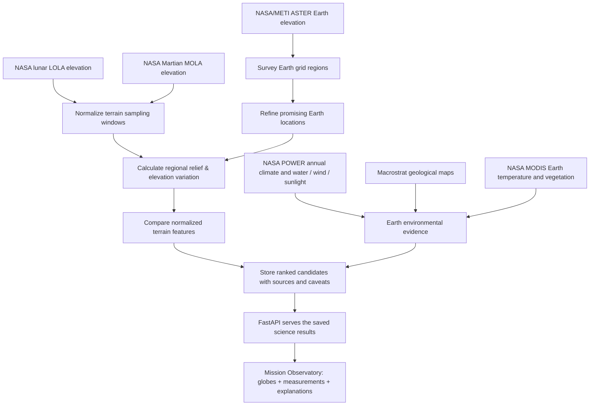

# PLANETREX
### Explore the Moon and Mars. Discover their terrain counterparts on Earth.

**PLANETREX** is an interactive planetary analog discovery prototype inspired by the NASA Space Apps challenge to identify terrestrial environments useful for future Moon-base and Mars exploration research.

PLANETREX combines **measured Earth terrain, annual NASA weather and environmental observations, satellite vegetation and surface temperature, and mapped Earth geology** to identify promising places for planetary science field testing. Planetary reference sites are tied to NASA mission and terrain evidence.

### 🌍 [Open the live PLANETREX Mission Observatory](https://planetrex-explorer.onrender.com/observatory)

[Explore the application](https://planetrex-explorer.onrender.com/observatory) · [View the scientific data coverage](https://planetrex-explorer.onrender.com/science/coverage) · [Inspect the generated terrain dataset](data/terrain_survey.json)

---

## What you can explore

**01 — Choose the Moon or Mars.** Switch between the two planetary bodies and select a mapped research or mission site, such as Hadley Rille, Taurus–Littrow, Jezero Crater, or Gale Crater.

**02 — Explore both worlds together.** Interactive, textured globes show the planetary reference and its candidate Earth regions. Rotate and zoom, view both globes side by side, or focus on one globe at a time.

**03 — Discover new Earth regions.** PLANETREX searches **168 measured terrestrial terrain regions**, including less-discussed candidates. Filter by actual Earth conditions—dryness, cold, wind, sunlight, ruggedness, mapped rock units, or literature-backed rock-category correspondence—then select any location on the globe.

**04 — Explore real Earth field evidence.** Each profiled Earth region includes NASA POWER 2025 annual air temperature, precipitation, wind and solar measurements, along with mapped lithology from Macrostrat. Select a site for additional NASA MODIS land-surface temperature and vegetation measurements, with explicit quality checks.

**05 — Compare Moon/Mars to Earth with evidence.** Elevation relief and variation are compared numerically. For documented sites including Apollo 15/Hadley Rille, Jezero Delta and Gale Crater, PLANETREX also checks whether an Earth mapped rock class corresponds to published NASA/USGS geological descriptions. Measurements and links show what makes each location a useful research lead.

## How PLANETREX works



The central idea is **data first, visualization second**. Terrain measurements are collected and processed in batch; the website reads the stored results instead of repeating the global analysis on every visit.

### How a terrain match is calculated

Each candidate and reference is represented by two measurements from a roughly **24 km-wide sampling footprint**:

- **Elevation relief:** highest sampled elevation minus lowest sampled elevation.
- **Elevation variation:** standard deviation of the sampled elevations.

The prototype compares their transformed differences:

```text
terrain distance =
    0.6 × |log(1 + Moon/Mars relief) − log(1 + Earth relief)|
  + 0.4 × |log(1 + Moon/Mars elevation variation)
         − log(1 + Earth elevation variation)|
```

**A lower terrain distance means a closer match in these two terrain descriptors.** It is **not** a percentage, a validated geological similarity score, or a prediction of landing or base suitability. The evidence report also checks how rankings respond to alternative feature weights.

## What has been analyzed so far

| Scientific research pilot | Current result |
| --- | --- |
| Initial Earth survey | **198** coarse grid positions checked |
| Earth regions with usable initial elevation samples | **72** |
| Additional nearby regions with usable refined samples | **96** |
| Documented Moon/Mars terrain reference regions | **8** |
| Additional Earth environmental/geological profiles | **65** (NASA POWER 2025 + Macrostrat responses) |
| Earth profiles with at least one mapped geological unit | **64** |
| Dimensions in numeric planet–Earth screening | **1 of 8: topography** |
| Other source-backed evidence | **Earth annual climate, mapped rock category, MODIS satellite context** |
| Terrain features compared within that dimension | **2: relief and elevation variation** |

The Earth survey runs a coarse global search and refines strong terrain candidates. Data-backed environmental filters help identify useful—and sometimes unexpected—field-research locations. Latitude/longitude are provided even when a local place name has not been independently verified.

## Where the scientific data comes from

| Source | Role in PLANETREX |
| --- | --- |
| [NASA LRO LOLA](https://svs.gsfc.nasa.gov/4720/) | Measured lunar elevation used for reference terrain profiles |
| [NASA Mars Global Surveyor MOLA](https://pds-geosciences.wustl.edu/missions/mgs/megdr.html) | Measured Martian elevation used for reference terrain profiles |
| [NASA/METI ASTER GDEM via Open Topo Data](https://www.opentopodata.org/datasets/aster/) | Sampled Earth elevation used in the terrain rankings |
| [NASA POWER](https://power.larc.nasa.gov/) | **2025 daily observations aggregated across the year**: air temperature, annual precipitation, wind and sunlight for 65 terrestrial candidates |
| [NASA Terra MODIS / ORNL DAAC](https://modis.ornl.gov/data/modis_webservice.html) | Quality-screened Earth land-surface temperature context |
| [Macrostrat](https://macrostrat.org/) | Real Earth geologic unit map data for the candidate regions, screened against published NASA/USGS rock-class references where available |
| [NASA/USGS MRO CTX stereo DTMs](https://stac.astrogeology.usgs.gov/docs/data/mars/ctxdtms/) | Additional Martian terrain scenes and archive evidence; not yet incorporated into the main analog score |
| [NASA Earthdata](https://search.earthdata.nasa.gov/) and [NASA PDS](https://pds.nasa.gov/) | Scientific dataset and planetary archive discovery |

**Visuals are separate from measurements.** Planet globe textures come from [Solar System Scope](https://www.solarsystemscope.com/textures/) (CC BY 4.0); textures are visual assets, not the scientific topographic data used to rank analogs.

## How the application is built

- **Scientific processing — Python:** batch pipelines ingest planetary elevation rasters, sample Earth terrain, derive comparable features, refine promising locations, and save evidence-backed candidate rankings as versioned data.
- **Backend — FastAPI:** serves mission-site references, precomputed terrain candidates, scientific comparisons, source metadata, and on-demand Earth observations.
- **Interactive observatory — HTML, CSS, and JavaScript Canvas:** displays smooth, rotatable Earth/Moon/Mars globes, site markers, dual and single views, candidate selections, and a compact measurement panel.
- **Hosting and verification — Render + GitHub Actions:** the public FastAPI application runs on Render; automated checks exercise scientific invariants and desktop/mobile browser interactions.

The user-facing observatory is available at **[planetrex-explorer.onrender.com/observatory](https://planetrex-explorer.onrender.com/observatory)**.

## What makes the approach different

PLANETREX is designed to **search Earth systematically rather than present only famous analog destinations**. It keeps the data-processing step separate from the visual interface, reports how candidates were screened, shows actual measurements and references, and makes missing scientific dimensions visible instead of filling them with invented percentages.

### Research interpretation

PLANETREX **does discover and characterize actual Earth field-research candidates** using independently sourced terrain, terrestrial climate and surface data, and mapped geology. The terrain distance compares two physical topographic descriptors; separate rock-class correspondence is a *categorical* check against documented geology. Temperature, wind, precipitation, solar, vegetation and land-surface records describe actual **Earth conditions** rather than invented planetary values.

This means a candidate can be scientifically interesting **without being certified or already famous**. Detailed lunar/Martian temperature, mineral abundance, ice, subsurface and engineering comparisons can be incorporated as their instrument products are harmonized with the Earth observations. The app preserves provenance, missingness and differences in planetary atmospheres, gravity and radiation rather than forcing unmeasured features into an unsupported percentage.

**Our aim is to find overlooked Earth sites worth investigating, show exactly why they stand out, and help mission teams select field experiments.**

---

**PLANETREX — Bringing planetary exploration back to Earth.**
